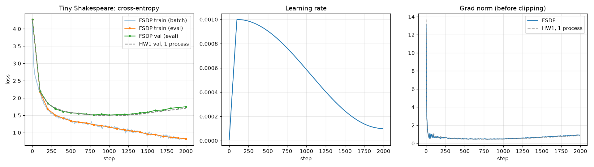

# ДЗ 2. FSDP-обучение Llama

Llama из ДЗ1, обученная через PyTorch FSDP2 (`fully_shard`). Шардирование по блокам: каждый блок трансформера (RMSNorm + attention + RMSNorm + MLP) это отдельный FSDP-юнит. Датасет и гиперпараметры те же, что в ДЗ1, поэтому кривые обучения можно сравнить напрямую.

## Файлы

| Файл | Что внутри |
|---|---|
| `llama.zip` | `model.py` и `train.py` из ДЗ1 без изменений, подключаются как библиотека |
| `train_fsdp.py` | инициализация процессов, шардирование, проверка против обычной модели, цикл обучения, чекпоинт, графики, генерация |
| `config.json` | конфиг из ДЗ1 без `overfit_steps` |
| `pyproject.toml`, `uv.lock` | зависимости (uv) |

`train_fsdp.py` добавляет `llama.zip` в `sys.path`, и Python импортирует модули прямо из архива (zipimport). Модель, токенизатор, загрузка данных, расписание lr, оптимизатор и `estimate_loss` берутся из ДЗ1, в ДЗ2 написано только то, что относится к FSDP. Архив собирается так:

```bash
cd homework-01 && zip -X ../homework-02/llama.zip model.py train.py
```

## Запуск

```bash
uv sync
# CPU, 2 процесса (так получены результаты ниже)
OMP_NUM_THREADS=4 uv run torchrun --nproc-per-node=2 --master-addr=127.0.0.1 --master-port=29500 train_fsdp.py
# CUDA, 2 GPU
uv run torchrun --standalone --nproc-per-node=2 train_fsdp.py
uv run tensorboard --logdir outputs/tensorboard
```

Если есть CUDA, используется NCCL и по GPU на процесс, иначе CPU и Gloo. MPS не подходит: для него нет бэкенда коллективных операций. На маке `--standalone` у меня зависал на rendezvous (поднимался на IPv6-адресе хоста), с `--master-addr=127.0.0.1` работает. `torchrun` по умолчанию ставит `OMP_NUM_THREADS=1`, с 4 потоками на процесс обучение быстрее.

`batch_size` в конфиге глобальный: каждый из N процессов берёт свои `batch_size / N` последовательностей, поэтому шаг оптимизатора видит те же 32 последовательности, что в ДЗ1.

## Как устроено шардирование

```python
torch.manual_seed(seed)              # одинаковая инициализация на всех процессах
model = Llama(model_cfg).to(device)
for block in model.layers:
    fully_shard(block, mesh=mesh)    # юнит на блок: norm + attn + norm + mlp
fully_shard(model, mesh=mesh)        # корень: эмбеддинги, финальный norm, output
```

`TransformerBlock` из ДЗ1 уже содержит ровно attention_norm, attention, ffn_norm и feed_forward, поэтому новый модуль-обёртка не нужен. Всё, что не попало в блоки (эмбеддинги, финальный RMSNorm, выходная голова), шардирует корневой вызов.

FSDP2 заменяет каждый параметр на `DTensor` с размещением `Shard(0)`: процесс хранит свою часть строк каждой матрицы. Что происходит за шаг:

1. Перед forward блока all-gather собирает его полные веса, после forward они снова освобождаются, так что в памяти полностью собран только текущий блок.
2. В backward блок собирается ещё раз, считаются градиенты, reduce-scatter усредняет их между процессами и оставляет каждому градиент только его шарда.
3. AdamW обновляет локальные шарды, поэтому моменты оптимизатора тоже шардированы.

Корневой юнит после forward не освобождается, он нужен в backward сразу же (выходная голова считается последней).

Сколько параметров хранит каждый процесс при двух процессах:

| Юнит | Всего | На процесс |
|---|---:|---:|
| `root` (эмбеддинги, norm, output) | 33 536 | 17 024 |
| `layers.0` … `layers.5`, каждый | 852 480 | 426 240 |
| итого | 5 148 416 | 2 574 464 |

В `root` разбиение неровное: в словаре 65 токенов, 65 строк делятся на процессы как 33 и 32.

Модель создаётся целиком на каждом процессе и уже потом шардируется. Для 5 млн параметров это не важно. Для модели, которая не помещается в память одного устройства, её строят на `meta`-устройстве и инициализируют уже шарды, но тогда инициализацию из ДЗ1 пришлось бы переписать.

## Проверка, что FSDP считает то же самое

Перед обучением `train_fsdp.py` пять шагов параллельно обучает две копии с одной инициализацией: шардированную, где каждый процесс видит свою часть батча, и обычную модель, которая на каждом процессе видит весь батч. На каждом шаге сравнивается средний loss и норма градиента до клиппинга, в конце все параметры (шарды собираются через `full_tensor()`). Всё совпадает с точностью до 1e-4.

Чтобы убедиться, что проверка вообще способна упасть, я по очереди ломал скрипт:

| Поломка | Чем поймана |
|---|---|
| все процессы берут одну и ту же часть батча | loss |
| у процессов разная инициализация | loss |
| градиенты складываются, а не усредняются (loss × N) | норма градиента |

Норму градиента сравнивать нужно обязательно. AdamW почти не реагирует на масштаб градиента, а после клиппинга он вообще сокращается, поэтому сумма вместо среднего прошла бы сравнение параметров незамеченной.

## Как прошло обучение

2 процесса на CPU (Gloo), 2000 шагов, 574 с.



Серым пунктиром показан ДЗ1: тот же конфиг, один процесс без FSDP.

| Шаг | train FSDP | val FSDP | train ДЗ1 | val ДЗ1 |
|---:|---:|---:|---:|---:|
| 0 | 4,271 | 4,267 | 4,270 | 4,268 |
| 200 | 1,682 | 1,847 | 1,684 | 1,833 |
| 500 | 1,341 | 1,576 | 1,360 | 1,581 |
| 900 | 1,203 | 1,537 | 1,196 | 1,498 |
| 1200 | 1,083 | 1,523 | 1,103 | 1,497 |
| 1500 | 0,955 | 1,589 | 0,990 | 1,566 |
| 1999 | 0,819 | 1,748 | 0,851 | 1,705 |

Кривые идут вместе. Побитово они совпадать не должны: батчи выбираются другим генератором (у каждого процесса свой seed), и ДЗ1 считался на MPS. Лучший val loss 1,506 на шаге 1000, дальше модель переобучается так же, как в ДЗ1. Норма градиента на первом шаге 13,1, после 150-го шага держится в диапазоне 0,44–0,93.

Пример генерации (`temperature=0.8`, `top_k=20`, затравка `ROMEO:`):

```
ROMEO:
And she that shall we do this fault, the last,
Shall forget them to her buut that shows us slaughter.

ROMEO:
Is it would serve it, in whose virtue like haste.

BENVOLIO:
By this good flout, he came to the king.
```

Генерация идёт уже не через FSDP: после обучения все процессы собирают полный state dict на процессе 0 (`get_model_state_dict` с `full_state_dict=True`). Этот state dict загружается в обычную `Llama`, то есть чекпоинт в том же формате, что в ДЗ1.

## Что не проверено

- Запуск на CUDA с NCCL. Код для него есть, но у меня нет машины с двумя GPU. Результаты выше получены на CPU.
- Mixed precision (`MixedPrecisionPolicy` с bf16): на CPU bf16-матмулы медленные, а при сравнении с ДЗ1 добавились бы расхождения из-за точности.

## Где лежат результаты

| Путь | Что это |
|---|---|
| `outputs/training.png` | графики: loss train/val рядом с ДЗ1, learning rate, норма градиента |
| `outputs/tensorboard/` | логи TensorBoard, конфиг и пример генерации во вкладке Text |
| `outputs/history.json` | залогированные значения, время обучения, число процессов |
| `outputs/model.pt` | полный state dict после последнего шага и конфиг, в репозиторий не входит |
| `outputs/sample.txt` | сгенерированный текст |
